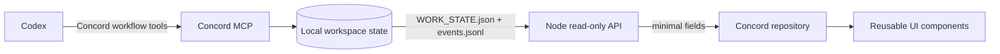

# ORBIT for Concord

ORBIT is a local, read-only mission-control interface for a Concord workspace. It presents real agent presence, task state, and workflow event metadata without claiming access to MCP server catalogs or tool-call results that Concord does not currently export to this view.


## What the data represents

The dashboard reads Concord's generated `.concord/WORK_STATE.json` and `.concord/events.jsonl` files through a loopback-only Node server. The UI refreshes every 5.5 seconds and also supports manual refresh and task search.

The available feed contains:

- **Presence:** agents Concord reports as live.
- **Tasks:** workspace tasks grouped by their recorded status.
- **Activity:** workflow event names, task IDs, statuses, and timestamps.

The current feed does not expose a complete MCP server registry, tool schemas, or full MCP execution results. ORBIT therefore does not invent online server badges, tool counts, execution charts, or success rates. Its green availability state means the local workspace files were readable; it does not assert that an MCP server is connected.

## Architecture



The code keeps the browser data source, domain mapping, UI components, rendering, and server responsibilities separate. There are no project runtime dependencies; the backend uses Node's built-in modules and the frontend uses native ES modules.

## Project structure

```text
.
├── index.html                       Semantic app shell and navigation
├── styles.css                       Design tokens, components, motion, responsive rules
├── app.js                           Browser bootstrap, polling, search, mobile navigation
├── server.js                        Loopback server and allow-listed read-only API
├── src/
│   ├── data/concordRepository.js    Fetches the local workspace feed
│   ├── domain/workspace.js          Normalizes tasks, presence, events, and metrics
│   └── ui/
│       ├── components.js            Shared task, event, and agent renderers
│       ├── icons.js                 One consistent SVG icon set
│       └── renderWorkspace.js       Maps domain data to the dashboard
├── screenshots/                     Desktop and mobile captures
└── AGENTS.md                        Concord workflow instructions
```

## Run locally

Requirements: Node.js 18 or newer, npm, and Concord MCP installed and configured for this folder.

```bash
npm start
```

Open [http://127.0.0.1:4173](http://127.0.0.1:4173). Keep the terminal open while using the dashboard. If the Concord state file is missing or cannot be parsed, ORBIT shows an unavailable state and keeps any prior display marked as potentially stale.

To create the local Concord workspace if needed:

```bash
npm install -g @concord-ai/concord-mcp
concord setup --no-global
```

On Windows Command Prompt, telemetry can be disabled for the setup command with:

```cmd
set CONCORD_TELEMETRY_DISABLED=1 && concord setup --no-global
```

Use **Ctrl+C** in the terminal to stop the server.

## Design and interaction

The interface uses a single tokenized visual system, reusable rendering helpers, a restrained lime signal palette, keyboard focus rings, a responsive navigation drawer, task search, gentle hover feedback, and reduced-motion support. Animations use CSS transforms and opacity and remain decorative; the actual state always comes from the local Concord feed.

The visual direction applies selected principles from [`design-taste-frontend`](https://github.com/Leonxlnx/taste-skill): a clear hierarchy, one coherent component system, purposeful motion, visible focus, mobile-specific navigation, and no fictional product metrics. The larger site kit was not copied into this repository because it would add unused assets and a second styling system.

## Data and privacy

- The server binds only to `127.0.0.1`.
- It only accepts `GET` requests and serves a fixed allow-list of app files.
- `/api/state` returns selected task, presence, and event fields; it omits machine paths, branches, expected-file lists, agent IDs, and event details.
- The database, workspace state, MCP config, and credentials remain local and are ignored by Git.
- No API key, hosted backend, or frontend framework is used.

## Screenshots


