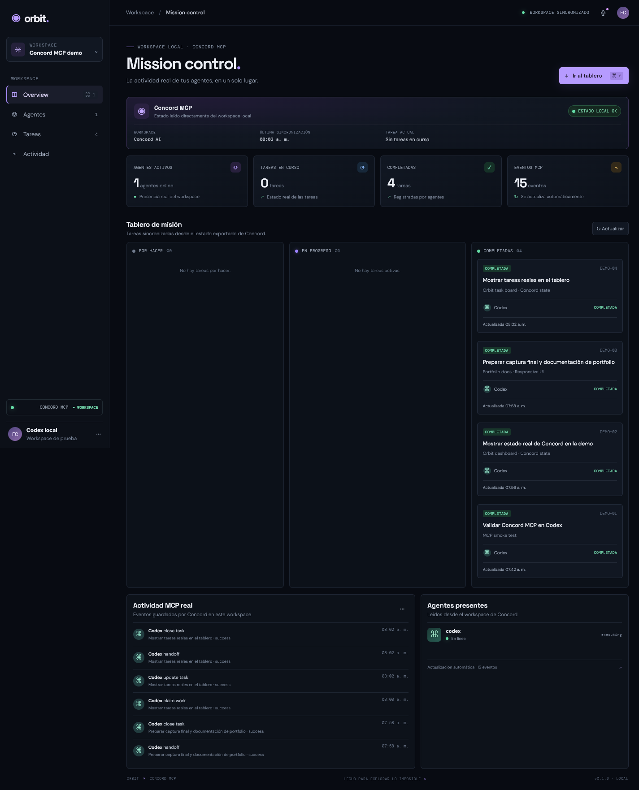
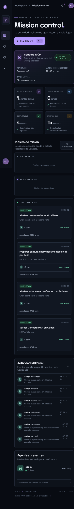
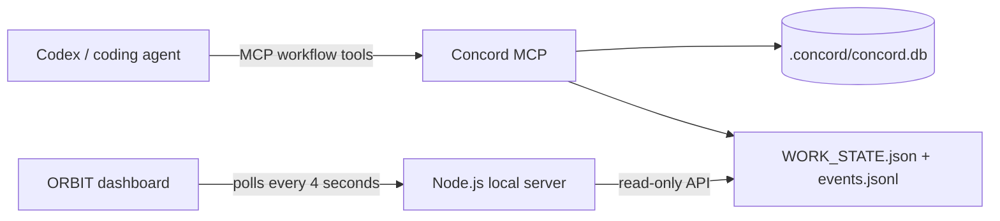

# ORBIT — Concord MCP Mission Control

A small local dashboard that makes Concord MCP's shared agent state visible: active sessions, task status, and the event trail. The UI reads Concord's generated workspace files; it does not send prompts or write tasks.





## What this demonstrates

Concord MCP gives coding agents a shared local work state. Agents can claim tasks, see ownership and overlap warnings, record handoffs, and leave review evidence. The MCP connection does not change a project's visual interface on its own. ORBIT adds a read-only dashboard so those workspace changes are visible.

## Architecture



## Project structure

```text
.
├── index.html          Dashboard layout
├── styles.css          Responsive dark interface
├── app.js              Renders live workspace state and event history
├── server.js           Local, read-only HTTP server and state endpoint
├── package.json        npm start script; no project dependencies
├── screenshots/        Portfolio screenshot
├── AGENTS.md           Concord workflow instructions for coding agents
└── .concord/           Local database and generated state (ignored by Git)
```

## Run locally

Requirements: Node.js 18 or newer, npm, and the Concord MCP package.

```bash
npm install -g @concord-ai/concord-mcp
concord setup --no-global
npm start
```

Open [http://127.0.0.1:4173](http://127.0.0.1:4173). Keep the terminal running while viewing the dashboard. In Codex, restart the Concord MCP server and trust its hooks if you want live agent-to-agent delivery; the dashboard itself reads local exported state and does not require an API key.

On Windows Command Prompt, telemetry can be disabled for the setup command with:

```cmd
set CONCORD_TELEMETRY_DISABLED=1 && concord setup --no-global
```

Use **Ctrl+C** in the terminal to stop the local server.

## Data and privacy

The server binds only to `127.0.0.1`, exposes only the three front-end files and a read-only `/api/state` endpoint, and reads `.concord/WORK_STATE.json` plus `.concord/events.jsonl`. The generated database and workspace state stay local and are excluded from Git. No project dependencies, API keys, or hosted services are used.

## Concord workflow used in this demo

The integration was exercised from Codex with `start_work`, `inspect_work`, and `finish_work`. The dashboard displays the resulting task, active agent, and MCP event history from the local Concord workspace.
